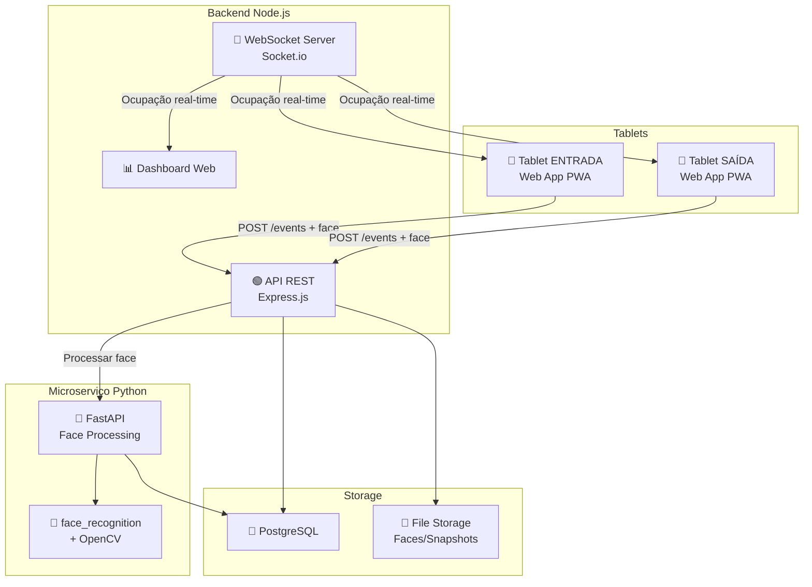

# apMonitora - Sistema de Monitoramento de Entrada/Saída

Sistema web para tablets que monitora entrada e saída de pessoas usando detecção facial, com contagem de ocupação em tempo real.

## Contexto e Decisões

| Decisão | Escolha | Justificativa |
|---------|---------|---------------|
| Plataforma | Web App (PWA) | Rápido de iterar, fallback para nativo se necessário |
| Reconhecimento Facial | Detecção (sem identificação inicial) | Simples e sem LGPD pesada; futuramente, rotulagem manual |
| Entrada/Saída | 2 tablets separados | Um na entrada, outro na saída, sincronizados via servidor |
| Backend | Híbrido (Node.js + Python) | Node.js para API REST/WebSocket, Python para CV/ML |
| Volume | ~500 pessoas/dia | Dimensionamento dos recursos |
| Persistência | Servidor com banco de dados | PostgreSQL |
| Conectividade | Internet obrigatória | Sincronização em tempo real |

## Arquitetura Geral



---

## User Review Required

> [!IMPORTANT]
> **Estrutura do Monorepo**: O projeto será organizado como monorepo com 3 pacotes:
> - `frontend/` — Web App (PWA) para tablets + dashboard
> - `backend/` — API Node.js (Express + Socket.io)
> - `face-service/` — Microserviço Python (FastAPI + OpenCV)

> [!WARNING]
> **Limite do WebRTC**: A API `getUserMedia` em browsers de tablets pode ter limitações de resolução e frame rate dependendo do modelo. Se a performance não atender, será necessário migrar para app nativo (React Native com react-native-camera).

> [!IMPORTANT]
> **Banco de Dados**: Estou propondo PostgreSQL. Você já tem uma instância disponível ou precisamos configurar uma? Docker?

---

## Proposed Changes

### Fase 1 — Fundação (Backend + Database)

#### Componente: Database Schema

##### [NEW] `backend/prisma/schema.prisma`

Modelos do banco de dados:

```prisma
model Device {
  id        String   @id @default(uuid())
  name      String               // "Entrada Principal", "Saída Lateral"
  type      DeviceType           // ENTRY | EXIT
  location  String?              // Localização física
  isActive  Boolean  @default(true)
  events    Event[]
  createdAt DateTime @default(now())
  updatedAt DateTime @updatedAt
}

model Event {
  id          String    @id @default(uuid())
  deviceId    String
  device      Device    @relation(fields: [deviceId], references: [id])
  type        EventType // ENTRY | EXIT
  faceImageUrl String?  // URL do snapshot do rosto
  embedding   Float[]?  // Face embedding (512 dimensões)
  personId    String?   // Vinculado após rotulagem
  person      Person?   @relation(fields: [personId], references: [id])
  confidence  Float?    // Confiança da detecção (0-1)
  timestamp   DateTime  @default(now())
}

model Person {
  id        String   @id @default(uuid())
  name      String
  label     String?  // Rótulo/categoria
  photoUrl  String?  // Foto de referência
  events    Event[]
  faces     PersonFace[]
  createdAt DateTime @default(now())
}

model PersonFace {
  id        String  @id @default(uuid())
  personId  String
  person    Person  @relation(fields: [personId], references: [id])
  embedding Float[] // Face embedding de referência
  imageUrl  String
}

model Occupancy {
  id        String   @id @default(uuid())
  location  String   @default("main")
  count     Int      @default(0)
  updatedAt DateTime @updatedAt
}

enum DeviceType {
  ENTRY
  EXIT
}

enum EventType {
  ENTRY
  EXIT
}
```

---

#### Componente: Backend Node.js (API REST + WebSocket)

##### [NEW] `backend/package.json`
- Express.js, Socket.io, Prisma Client, Multer (upload de imagens), CORS, dotenv

##### [NEW] `backend/src/server.js`
- Servidor Express + Socket.io
- Middlewares: CORS, JSON, upload de arquivos

##### [NEW] `backend/src/routes/devices.js`
- `GET /api/devices` — Listar dispositivos
- `POST /api/devices` — Registrar novo tablet
- `PATCH /api/devices/:id` — Atualizar dispositivo
- `DELETE /api/devices/:id` — Remover dispositivo

##### [NEW] `backend/src/routes/events.js`
- `POST /api/events` — Registrar evento de entrada/saída (recebe imagem + metadata)
- `GET /api/events` — Listar eventos com filtros (data, tipo, dispositivo)
- `GET /api/events/stats` — Estatísticas (entradas/saídas por hora, dia)

##### [NEW] `backend/src/routes/occupancy.js`
- `GET /api/occupancy` — Contagem atual de ocupação
- `GET /api/occupancy/history` — Histórico de ocupação

##### [NEW] `backend/src/routes/persons.js`
- `GET /api/persons` — Listar pessoas rotuladas
- `POST /api/persons` — Criar pessoa com rótulo
- `POST /api/persons/:id/faces` — Vincular face a pessoa
- `GET /api/persons/:id/report` — Relatório de uma pessoa

##### [NEW] `backend/src/services/occupancyService.js`
- Lógica de incremento/decremento da ocupação
- Emissão de evento WebSocket para todos os clientes conectados

##### [NEW] `backend/src/services/faceService.js`
- Cliente HTTP para comunicação com o microserviço Python
- Envio de imagem para processamento
- Recebimento de embedding e resultados de matching

##### [NEW] `backend/src/websocket/handler.js`
- Gerenciamento de conexões WebSocket
- Rooms: `tablet:entrada`, `tablet:saida`, `dashboard`
- Eventos: `occupancy:update`, `event:new`, `device:status`

---

### Fase 2 — Microserviço Python (Face Processing)

#### Componente: Face Service (FastAPI)

##### [NEW] `face-service/requirements.txt`
- fastapi, uvicorn, face-recognition, opencv-python-headless, numpy, Pillow, python-multipart

##### [NEW] `face-service/main.py`
- FastAPI app com endpoints para processamento facial

##### [NEW] `face-service/routers/detection.py`
- `POST /detect` — Recebe imagem, retorna faces detectadas + bounding boxes
- `POST /embedding` — Recebe imagem de face, retorna embedding (128 dim)
- `POST /match` — Recebe embedding, compara com embeddings conhecidos

##### [NEW] `face-service/services/face_processor.py`
- Detecção de faces com face_recognition (baseado no dlib)
- Geração de embeddings
- Comparação/matching de faces
- Crop e normalização da imagem do rosto

##### [NEW] `face-service/services/image_utils.py`
- Utilidades de processamento de imagem (resize, encode/decode base64, crop)

---

### Fase 3 — Frontend (Web App PWA para Tablets)

#### Componente: App Web (Vite + Vanilla JS)

> **Decisão técnica**: Vite + HTML/CSS/JS puro (sem framework pesado). Razões:
> - Simplicidade para um app de câmera single-page
> - Performance máxima em tablets
> - face-api.js para detecção client-side (pré-processamento antes de enviar ao servidor)
> - Menor footprint

##### [NEW] `frontend/index.html`
- Estrutura base da PWA
- Meta tags para tablet (viewport, fullscreen)

##### [NEW] `frontend/manifest.json`
- Configuração PWA (nome, ícones, display: standalone, orientation: portrait)

##### [NEW] `frontend/sw.js`
- Service Worker para funcionalidade PWA

##### [NEW] `frontend/src/main.js`
- Entry point, roteamento simples baseado em hash
- Inicialização do WebSocket

##### [NEW] `frontend/src/pages/setup.js`
- **Tela de configuração** (primeira vez):
  - Nome do dispositivo
  - Tipo: ENTRADA ou SAÍDA
  - Registra no backend via POST /api/devices

##### [NEW] `frontend/src/pages/monitor.js`
- **Tela principal de monitoramento**:
  - Preview da câmera em tela cheia
  - Detecção de face em tempo real (face-api.js client-side)
  - Auto-captura quando face detectada (snapshot)
  - Envio para backend (POST /api/events)
  - Contador de ocupação em tempo real (Socket.io)
  - Indicador visual: ENTRADA (verde) ou SAÍDA (vermelho)
  - Animação de confirmação ao registrar

##### [NEW] `frontend/src/pages/dashboard.js`
- **Dashboard gerencial** (acessível de qualquer navegador):
  - Contagem de ocupação em tempo real
  - Gráfico de entradas/saídas por hora
  - Últimos eventos com fotos
  - Status dos dispositivos conectados
  - Painel de rotulagem de pessoas

##### [NEW] `frontend/src/services/camera.js`
- API de câmera (getUserMedia)
- Captura de frame
- Stream management (start/stop)

##### [NEW] `frontend/src/services/faceDetection.js`
- face-api.js para detecção client-side
- Carregamento dos modelos TinyFaceDetector
- Desenho dos bounding boxes no canvas

##### [NEW] `frontend/src/services/websocket.js`
- Cliente Socket.io
- Conexão, reconexão automática
- Handlers para eventos de ocupação

##### [NEW] `frontend/src/services/api.js`
- Cliente HTTP para a API REST
- Endpoints: devices, events, occupancy, persons

##### [NEW] `frontend/src/styles/main.css`
- Design system completo
- Otimizado para touch/tablet
- Tema escuro para uso em portaria
- Animações de feedback visual

---

### Fase 4 — Dashboard e Relatórios

##### [NEW] `frontend/src/pages/reports.js`
- Relatório de movimentação por período
- Relatório de ocupação por horário
- Relatório de pessoas rotuladas
- Exportação CSV/PDF

##### [NEW] `frontend/src/pages/labeling.js`
- Interface de rotulagem de faces não identificadas
- Galeria de faces capturadas
- Formulário para vincular face a pessoa
- Busca por similaridade facial

---

## Estrutura Final do Projeto

```
apMonitora/
├── backend/                    # API Node.js
│   ├── prisma/
│   │   └── schema.prisma
│   ├── src/
│   │   ├── routes/
│   │   │   ├── devices.js
│   │   │   ├── events.js
│   │   │   ├── occupancy.js
│   │   │   └── persons.js
│   │   ├── services/
│   │   │   ├── occupancyService.js
│   │   │   └── faceService.js
│   │   ├── websocket/
│   │   │   └── handler.js
│   │   └── server.js
│   ├── uploads/                # Imagens de faces
│   ├── package.json
│   └── .env
│
├── face-service/               # Microserviço Python
│   ├── routers/
│   │   └── detection.py
│   ├── services/
│   │   ├── face_processor.py
│   │   └── image_utils.py
│   ├── main.py
│   └── requirements.txt
│
├── frontend/                   # Web App PWA
│   ├── public/
│   │   ├── models/             # face-api.js models
│   │   └── icons/
│   ├── src/
│   │   ├── pages/
│   │   │   ├── setup.js
│   │   │   ├── monitor.js
│   │   │   ├── dashboard.js
│   │   │   ├── reports.js
│   │   │   └── labeling.js
│   │   ├── services/
│   │   │   ├── camera.js
│   │   │   ├── faceDetection.js
│   │   │   ├── websocket.js
│   │   │   └── api.js
│   │   ├── styles/
│   │   │   └── main.css
│   │   └── main.js
│   ├── index.html
│   ├── manifest.json
│   ├── sw.js
│   └── vite.config.js
│
└── docker-compose.yml          # Orquestração local
```

---

## Open Questions

> [!IMPORTANT]
> **PostgreSQL**: Você já tem uma instância PostgreSQL rodando ou devemos usar Docker para subir uma? Posso incluir um `docker-compose.yml` completo.

> [!IMPORTANT]
> **Prioridade de implementação**: Sugiro começar pela **Fase 1 + Fase 3 (Setup + Monitor)** como MVP, para ter rapidamente um tablet funcionando com câmera e contagem. Concorda?

---

## Verification Plan

### Automated Tests
- **Backend**: Testes de integração das rotas com Vitest/Jest
- **Face Service**: Testes com imagens de exemplo para validar detecção
- **Frontend**: Teste manual via browser + verificação de câmera em tablet real

### Manual Verification
1. Abrir o app em 2 tablets (ou 2 abas simulando tablets)
2. Configurar um como ENTRADA e outro como SAÍDA
3. Registrar passagem de pessoas em ambos
4. Verificar no dashboard que a contagem de ocupação está correta
5. Verificar que as faces são capturadas e armazenadas

### Performance
- Medir tempo de detecção facial client-side (target: < 200ms)
- Medir latência do WebSocket para atualização de ocupação (target: < 500ms)
- Testar com 50+ eventos em sequência para verificar estabilidade
